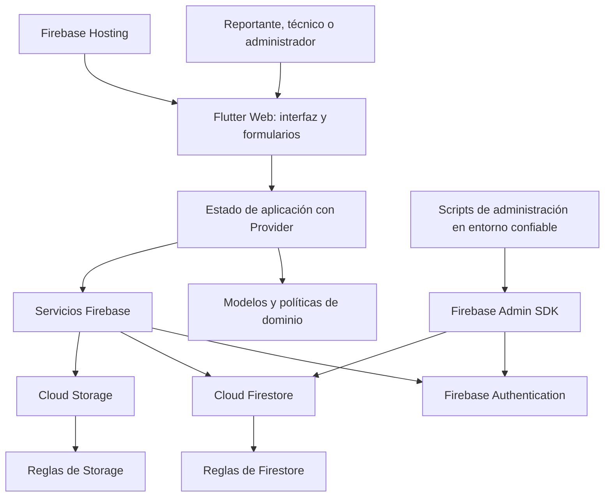
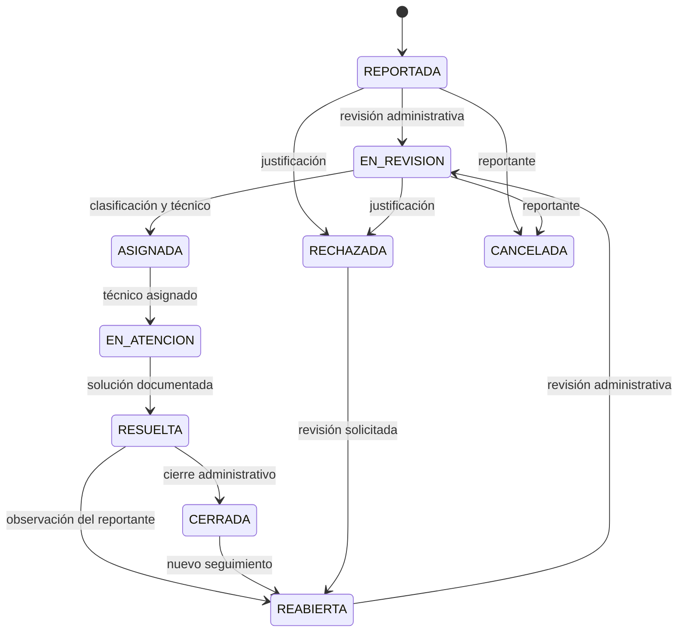

# Arquitectura de CampusFix

## Componentes

Hosting sirve la aplicación compilada; no procesa las reglas de negocio. El cliente habla con Authentication, Firestore y Storage mediante sus SDK oficiales. Las reglas validan las operaciones independientemente de los controles visibles en pantalla. Los scripts administrativos se ejecutan fuera del navegador.

## Separación de responsabilidades

| Capa | Responsabilidad |
| --- | --- |
| Interfaz | `lib/ui/app.dart`: navegación, formularios validados, presentación de listados, detalle, tableros y estados de carga/error. |
| Estado | `lib/state/`: sesión y perfil, suscripciones, filtros, selección y notificaciones a widgets mediante Provider. |
| Dominio | Perfiles, categorías, incidentes, prioridades, estados, transiciones y cálculo de indicadores. |
| Servicios | `lib/data/firebase_repository.dart`: consultas y escrituras Firestore, transacciones, autenticación y carga/lectura de imágenes. |
| Seguridad | Reglas de Firestore/Storage, perfiles activos, participantes y campos permitidos. |

Los modelos están en `lib/domain/models.dart`; la política del flujo en `lib/domain/incident_policy.dart`; los indicadores en `lib/domain/dashboard_metrics.dart`. La inicialización está en `lib/main.dart`. La matriz de [Requisitos](REQUISITOS.md) identifica los puntos de implementación de cada historia.

El estado se distribuye mediante `AuthState`, `IncidentState`, `DashboardState` y `ThemeState`. Los formularios tienen estado local con widgets `StatefulWidget`, controladores y claves `GlobalKey<FormState>` de Flutter: los borradores y sus validaciones pertenecen al formulario; los datos persistentes y las suscripciones pertenecen a los controladores de aplicación.

## Modelo documental

| Ruta | Datos y finalidad |
| --- | --- |
| `users/{uid}` | `name`, `email`, `role`, `active`, `createdAt`, `updatedAt`. El UID corresponde a Authentication. |
| `categories/{id}` | Nombre, descripción, disponibilidad y fechas; catálogo administrado. |
| `incidents/{id}` | Número visible, título, descripción, categoría, ubicación, prioridad, estado, creador, técnico y fechas. |
| `incidents/{id}/events/{eventId}` | Autor, fecha y detalle de la creación, clasificación, asignación o transición. |
| `incidents/{id}/comments/{commentId}` | Seguimiento escrito con autor y fecha. |
| `incidents/{id}/evidence/{evidenceId}` | Metadatos y ruta privada del archivo en Storage. |

Los estados se guardan como códigos sin tildes (`EN_REVISION`, `EN_ATENCION`) y se presentan con etiquetas legibles en español. Separar comentarios, historial y evidencia en subcolecciones evita que crezca indefinidamente un único arreglo dentro del documento principal.

El número visible identifica el caso y permite buscarlo. El ID de Firestore es la identidad técnica. La implementación incluye un sufijo derivado de ese ID para evitar coordinación global de un contador; no debe interpretarse como una secuencia numérica correlativa sin saltos.

## Ciclo de vida

La asignación requiere una categoría y prioridad válidas, además de un técnico activo. Una incidencia resuelta exige texto de solución. El cierre requiere estado resuelto. La interfaz muestra las acciones permitidas para la persona y el estado actuales; Firestore vuelve a comprobarlas al guardar.

Cada cambio operativo incrementa `version` y asocia `lastEventId` a un evento. Se escribe el incidente y su evento en una operación atómica para que el estado no avance sin dejar trazabilidad. La versión ayuda a detectar una edición basada en datos antiguos cuando dos personas trabajan sobre el mismo caso. Los eventos no se editan desde el cliente.

## Acceso y evidencia

| Persona | Alcance de lectura | Operaciones principales |
| --- | --- | --- |
| Reportante activo | Sus propios reportes y sus subcolecciones. | Crear casos, comentar y adjuntar evidencia; cancelación temprana y solicitud de reapertura según estado. |
| Técnico activo | Casos asignados a su UID. | Iniciar atención, registrar avances y resolver sus asignaciones. |
| Administrador activo | Supervisión general. | Clasificar, asignar, cerrar, gestionar perfiles y categorías y consultar indicadores. |

Los permisos parten del perfil persistido en Firestore. Registrar una cuenta solo crea rol reportante. La promoción inicial a administrador requiere un script con Admin SDK; las promociones siguientes se hacen con un administrador existente. Un perfil inactivo pierde acceso operativo aunque exista una sesión de Authentication.

Las fotos se guardan en `incidents/{incidentId}/{uid}/{uuid}`. Storage verifica sesión, perfil y acceso al caso, además de tamaño y tipo MIME. El servicio conserva la ruta del objeto y obtiene sus bytes con autorización para mostrarlos. El tamaño máximo de 5 MiB se comprueba tanto en el cliente como en reglas. El MIME es una validación de metadatos, no un análisis de contenido de la imagen.

## Tiempo real y consultas

Las suscripciones `snapshots()` de Firestore alimentan el estado con cambios de incidentes y sus subcolecciones. Provider notifica los widgets que dependen de esos datos. No se incluye un servidor WebSocket adicional: Firestore proporciona el canal de actualización. [Documentación oficial de listeners](https://firebase.google.com/docs/firestore/query-data/listen).

El reportante consulta por creador y el técnico por responsable; así, sus consultas respetan el alcance de seguridad. El administrador obtiene la vista operativa autorizada. La búsqueda de texto y los filtros se aplican sobre el conjunto recibido; Firestore no se usa como motor de búsqueda de texto completo. Los indicadores se calculan sobre ese conjunto y reflejan su alcance. Para una operación con grandes volúmenes, conviene revisar paginación, lecturas y agregaciones antes de aumentar la carga.

## Entornos

En desarrollo se utilizan los emuladores reales de Auth, Firestore y Storage con el proyecto local `demo-campusfix`. El modo de emuladores se activa durante la compilación. En producción se usan los identificadores reales del proyecto con ese modo desactivado. Los scripts de semilla comprueban el entorno para no cargar cuentas de demostración en producción.

El proyecto de producción de esta entrega es `campusfix-ae32e`, con Firestore `(default)` en `us-central1` y la aplicación web `1:550971519365:web:eec2c84880e516433454ec`. Authentication por correo/contraseña está habilitado. El sitio publicado es [CampusFix](https://campusfix-ae32e.web.app). Para mantener la entrega sin facturación, el usuario decidió demostrar las fotografías con Storage en emuladores y dejar Storage de producción pendiente. La arquitectura conserva ese servicio; las imágenes no se trasladan a documentos Firestore. `STORAGE_ENABLED=false` oculta la acción para adjuntar en producción y muestra el aviso correspondiente; en emuladores la función está disponible.

Las versiones resueltas se conservan en los archivos de bloqueo. Las reglas e índices se versionan con el código y se despliegan desde el mismo paquete. El proceso de [Firebase y publicación](FIREBASE.md) explica la preparación del proyecto, el primer administrador y la verificación posterior al despliegue.
